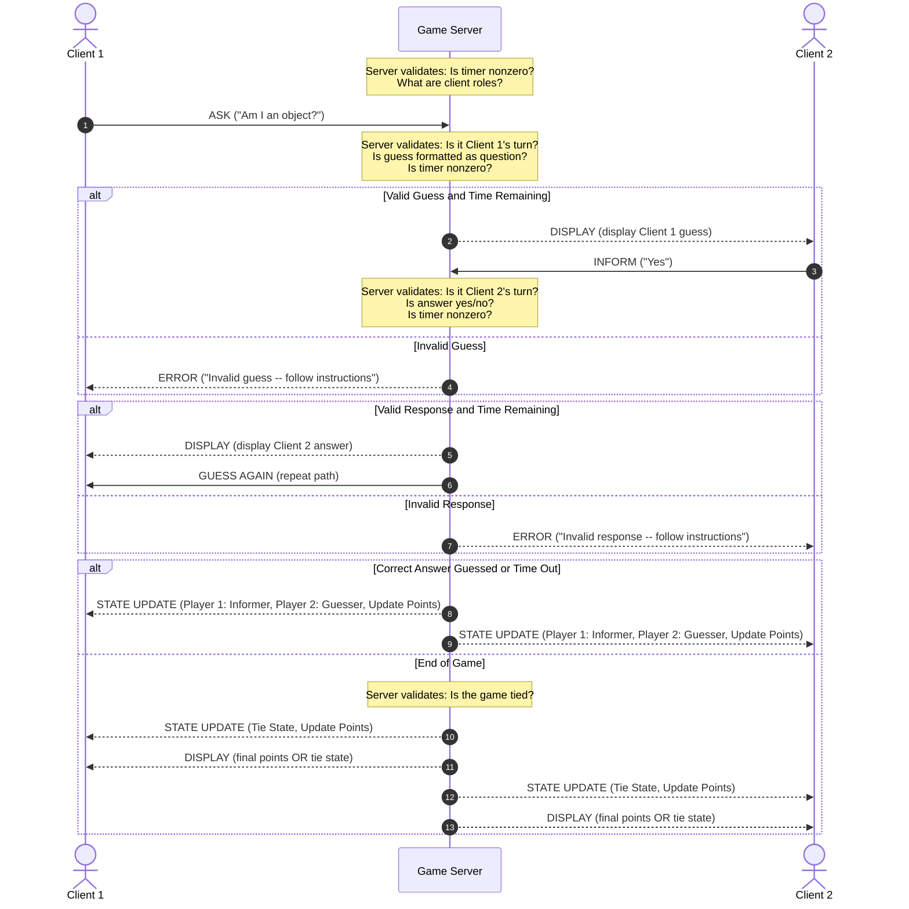

### State & Score Synchronization Across Clients

- **Turn Enforcement:** The respective identity of the clients is what enforces their turn behavior. Each client has a state variable that is only updated at the end of a turn (either by correct guess or time out), with the exception of the final round. The variable can either be "Guesser" (1) or "Informer" (2). The Guesser displays the rules and behavior of the player guessing by enforcing question asking and returning to the beginning of the guess if an invalid input is received and there is still time. The Informer displays the rules and behavior of the player informing by enforcing yes or no question response and repeating the request for a response if an invalid input is received and there is still time. These roles are switched when time (synchronized across clients and server) is up, at which point state is updated between clients, enforcing the new turn rules. Guessers always go first, and Informers always respond to Guessers. The exception to this rule is in the tie breaking round, at which point turn enforcement is not enforced as both clients send guesses to the server that are displayed to both terminals with a yes or no response from the server.

- **Score & Board Synchronization:** State updates are used following entire rounds. As guesses and responses are easy to broadcast as single messages and don't need to be sent to both clients, a full state update (beyond a terminal update to maintain screen and time synchronization) is not used since roles are not being switched and points are not being updated. When a round is over, STATE_UPDATE broadcasts containing a client's new role, the role of the other client, and the current points. If it is the final round, STATE_UPDATE only contains the final points and tie state, as roles are unnecessary at that point. Since new-line delimited JSON payloads are used for message sending, messages can be broadcast in a single stream using `threading.Lock` and `socket.Sendall` to prevent overwriting the other client's intended message while the broadcast is being sent simultaneously.